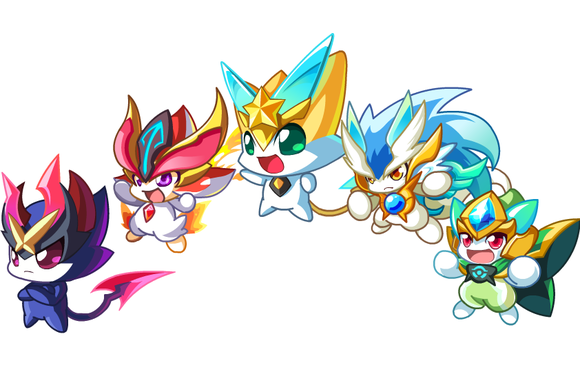

# 🎮 奥奇传说主题美化插件 for DeepSeek Harness

一个为 DeepSeek Harness 设计的全功能主题美化插件，以百田游戏公司旗下的《奥奇传说》为主题，带来全新的视觉体验和实用功能。

## ✨ 主要特性

### 🎨 界面美化
- **渐变背景**：精心设计的紫色渐变背景，营造梦幻氛围
- **圆角卡片**：所有元素采用圆角设计，更加柔和美观
- **阴影效果**：立体阴影让界面更有层次感
- **自定义滚动条**：带渐变色的精美滚动条
- **动画效果**：流畅的过渡和悬停动画

### 🖱️ 点击特效
- 每次点击都会产生多彩的粒子特效
- 随机形状（●、★、♥、◆、✦）
- 随机颜色（蓝、橙、绿、紫、红）
- 飘动旋转动画

### 🔔 任务完成通知
- **系统通知**：任务完成时弹出系统通知
- **页面通知**：优雅的页面内通知卡片
- **最小化提醒**：页面最小化时仍能收到通知
- **角色语音**：随机选择奥奇角色为你播报

### 📊 输出优化
- 移除默认的输出长度限制
- 自动添加"显示完整内容"按钮
- 智能滚动到最新内容
- 支持超长文本无缝显示

### 🐾 奥奇角色装饰
- 右下角显示可爱的奥奇角色
- 浮动动画效果
- 点击切换动画
- 包含六大主角：小舞王、小天、小严、阿瑞斯、阿修、小诺

### ⚙️ 控制面板
- 开关任务完成通知
- 开关点击特效
- 开关自动滚动
- 设置自动保存

## 📦 安装方法

### 方法一：Chrome 扩展（推荐）

1. 下载本插件源码
2. 打开 Chrome 浏览器，访问 chrome://extensions/
3. 打开右上角的"开发者模式"
4. 点击"加载已解压的扩展程序"
5. 选择插件文件夹 oqi-legend-theme-plugin
6. 完成！刷新 DeepSeek Harness 页面即可看到效果

### 方法二：用户脚本（Tampermonkey）

1. 安装 [Tampermonkey](https://www.tampermonkey.net/) 扩展
2. 点击 Tampermonkey 图标 → 管理面板
3. 点击"+"号创建新脚本
4. 复制 oqi-legend-userscript.js 的内容
5. 保存并启用脚本
6. 刷新 DeepSeek Harness 页面

### 方法三：直接注入（开发者）

`javascript
// 在浏览器控制台中运行
const script = document.createElement('script');
script.src = 'path/to/aoqi-legend-theme-plugin/src/content.js';
document.head.appendChild(script);

const style = document.createElement('link');
style.rel = 'stylesheet';
style.href = 'path/to/aoqi-legend-theme-plugin/src/styles.css';
document.head.appendChild(style);
`

## 🎯 功能说明

### 任务完成通知

当 DeepSeek Harness 完成任务时：
- 浏览器会弹出系统通知
- 页面右上角显示精美通知卡片
- 即使页面最小化也能收到提醒
- 通知会显示随机的奥奇角色签名

### 输出长度优化

插件自动解除 DeepSeek Harness 的输出长度限制：
- 自动移除 max-height 限制
- 为超长内容添加"显示完整内容"按钮
- 优化滚动体验
- 定期检查并优化新增内容

### 点击特效

每次点击页面任何位置：
- 生成 5 个随机形状的彩色粒子
- 粒子向上飘动并旋转
- 自动淡出消失
- 可在控制面板中关闭

### 控制面板

点击右下角角色上方的控制面板：
- 切换通知开关
- 切换点击特效开关
- 切换自动滚动开关
- 所有设置自动保存到本地

## 🎨 主题配色

`css
--aoqi-primary: #4A90E2;    /* 主色调 - 蓝色 */
--aoqi-secondary: #F5A623;  /* 次要色 - 橙色 */
--aoqi-accent: #7ED321;     /* 强调色 - 绿色 */
--aoqi-purple: #9B59B6;     /* 紫色 */
--aoqi-red: #E74C3C;        /* 红色 */
`

## 📂 文件结构

`
aoqi-legend-theme-plugin/
├── manifest.json              # Chrome 扩展配置文件
├── aoqi-legend-userscript.js  # Tampermonkey 用户脚本版本
├── README.md                  # 说明文档
├── README_EN.md              # 英文说明文档
├── LICENSE                    # 开源许可证
├── assets/                    # 资源文件夹
│   ├── images/               # 图片资源
│   │   ├── characters.png    # 角色图片（PNG）
│   │   ├── characters.gif    # 角色动画（GIF）
│   │   ├── icon-16.png       # 16x16 图标
│   │   ├── icon-48.png       # 48x48 图标
│   │   └── icon-128.png      # 128x128 图标
│   └── sounds/               # 音效文件夹（预留）
└── src/                      # 源代码文件夹
    ├── content.js            # 内容脚本（主要功能）
    ├── background.js         # 后台服务脚本
    └── styles.css            # 主题样式表
`

## 🔧 自定义配置

### 修改配色方案

编辑 src/styles.css 文件中的 CSS 变量：

`css
:root {
  --aoqi-primary: #YOUR_COLOR;
  --aoqi-secondary: #YOUR_COLOR;
  /* ... 其他颜色 */
}
`

### 修改角色列表

编辑 src/content.js 文件中的 CONFIG 对象：

`javascript
const CONFIG = {
  characters: ['你的角色1', '你的角色2', ...],
  // ... 其他配置
};
`

### 调整动画速度

在 src/styles.css 中找到对应的 animation 属性并修改时长：

`css
animation: float 3s ease-in-out infinite;
/* 改为 */
animation: float 5s ease-in-out infinite; /* 更慢的浮动 */
`

## 🌐 兼容性

- ✅ Chrome 88+
- ✅ Edge 88+
- ✅ Firefox 78+（需要转换为 Firefox 扩展格式）
- ✅ Opera 74+
- ✅ 支持所有基于 Chromium 的浏览器

## 🐛 已知问题

1. 某些情况下通知权限需要手动授予
2. 在高 DPI 屏幕上，角色图片可能需要调整大小
3. 过于频繁的点击可能导致性能下降（建议适度点击）

## 🔮 未来计划

- [ ] 添加更多奥奇角色
- [ ] 支持自定义背景图片
- [ ] 添加音效支持
- [ ] 提供多套主题切换
- [ ] 支持暗黑模式
- [ ] 添加快捷键支持
- [ ] 导出/导入设置功能
- [ ] 多语言支持

## 🤝 贡献指南

欢迎提交 Issue 和 Pull Request！

1. Fork 本项目
2. 创建特性分支 (git checkout -b feature/AmazingFeature)
3. 提交更改 (git commit -m 'Add some AmazingFeature')
4. 推送到分支 (git push origin feature/AmazingFeature)
5. 提交 Pull Request

## 📝 开发说明

### 本地开发

1. 克隆仓库
   `ash
   git clone https://github.com/fuguoqiang-bnu/aoqi-legend-theme-plugin.git
   `

2. 修改代码

3. 在 Chrome 中加载未打包的扩展进行测试

4. 提交代码

### 调试技巧

- 在 Chrome DevTools Console 中查看日志
- 使用 chrome://extensions/ 查看扩展状态
- 修改代码后点击"重新加载"按钮

## 📄 许可证

MIT License - 详见 [LICENSE](LICENSE) 文件

## 👏 致谢

- 感谢百田游戏公司创作了《奥奇传说》这款优秀游戏
- 感谢 DeepSeek 团队开发的 Harness 工具
- 感谢所有为本项目做出贡献的开发者

## 📮 联系方式

- 项目地址：https://github.com/fuguoqiang-bnu/aoqi-legend-theme-plugin
- 问题反馈：https://github.com/fuguoqiang-bnu/aoqi-legend-theme-plugin/issues
- 邮箱：your.email@example.com

## 🎮 关于奥奇传说

《奥奇传说》是由百田信息科技有限公司开发的一款儿童网页游戏。游戏以精灵收集、培养和对战为主要玩法，深受玩家喜爱。

本插件的六大主角：
- **小舞王**：可爱的舞蹈系精灵
- **小天**：强大的天空系精灵
- **小严**：勇敢的火焰系精灵
- **阿瑞斯**：神秘的战神系精灵
- **阿修**：酷炫的暗黑系精灵
- **小诺**：温柔的治愈系精灵

---

**如果这个插件对你有帮助，请给个 ⭐ Star 支持一下！**

Made with ❤️ by Aoqi Fans
