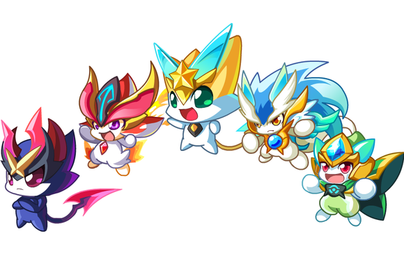

# 🎮 Aoqi Legend Theme Plugin for DeepSeek Harness

A comprehensive theme beautification plugin for DeepSeek Harness, themed after "Aoqi Legend" (Aola Star) by 100bt Games, bringing a fresh visual experience and practical features.

## ✨ Key Features

### 🎨 Interface Beautification
- **Gradient Background**: Carefully designed purple gradient background
- **Rounded Cards**: All elements use rounded corners for a softer look
- **Shadow Effects**: 3D shadows add depth to the interface
- **Custom Scrollbar**: Beautiful scrollbar with gradient colors
- **Animation Effects**: Smooth transitions and hover animations

### 🖱️ Click Effects
- Colorful particle effects on every click
- Random shapes (●, ★, ♥, ◆, ✦)
- Random colors (blue, orange, green, purple, red)
- Floating and rotating animations

### 🔔 Task Completion Notifications
- **System Notifications**: Pop-up system notifications on task completion
- **In-Page Notifications**: Elegant notification cards
- **Minimized Alerts**: Receive notifications even when window is minimized
- **Character Messages**: Random Aoqi character signatures

### 📊 Output Optimization
- Remove default output length restrictions
- Auto-add "Show Full Content" button
- Smart scroll to latest content
- Support for extra-long text display

### 🐾 Aoqi Character Decoration
- Cute Aoqi character in bottom-right corner
- Floating animation effect
- Click to trigger animation
- Features six main characters: Xiao Wu Wang, Xiao Tian, Xiao Yan, Ares, Axiu, Xiao Nuo

### ⚙️ Control Panel
- Toggle task completion notifications
- Toggle click effects
- Toggle auto-scroll
- Auto-save settings

## 📦 Installation

### Method 1: Chrome Extension (Recommended)

1. Download the plugin source code
2. Open Chrome and navigate to chrome://extensions/
3. Enable "Developer mode" in the top-right corner
4. Click "Load unpacked"
5. Select the oqi-legend-theme-plugin folder
6. Done! Refresh DeepSeek Harness to see the effects

### Method 2: Userscript (Tampermonkey)

1. Install [Tampermonkey](https://www.tampermonkey.net/)
2. Click Tampermonkey icon → Dashboard
3. Click "+" to create a new script
4. Copy the content from oqi-legend-userscript.js
5. Save and enable the script
6. Refresh DeepSeek Harness

### Method 3: Direct Injection (Developers)

`javascript
// Run in browser console
const script = document.createElement('script');
script.src = 'path/to/aoqi-legend-theme-plugin/src/content.js';
document.head.appendChild(script);

const style = document.createElement('link');
style.rel = 'stylesheet';
style.href = 'path/to/aoqi-legend-theme-plugin/src/styles.css';
document.head.appendChild(style);
`

## 🎯 Features Explained

### Task Completion Notifications

When DeepSeek Harness completes a task:
- Browser shows system notification
- Elegant notification card appears in top-right corner
- Works even when page is minimized
- Includes random Aoqi character signature

### Output Length Optimization

Plugin automatically removes DeepSeek Harness output length limits:
- Removes max-height restrictions
- Adds "Show Full Content" button for long content
- Optimizes scroll experience
- Periodically checks and optimizes new content

### Click Effects

On every page click:
- Generates 5 random-shaped colored particles
- Particles float upward and rotate
- Auto-fade out
- Can be disabled in control panel

### Control Panel

Access via panel above bottom-right character:
- Toggle notifications
- Toggle click effects
- Toggle auto-scroll
- All settings auto-save locally

## 🎨 Theme Colors

`css
--aoqi-primary: #4A90E2;    /* Primary - Blue */
--aoqi-secondary: #F5A623;  /* Secondary - Orange */
--aoqi-accent: #7ED321;     /* Accent - Green */
--aoqi-purple: #9B59B6;     /* Purple */
--aoqi-red: #E74C3C;        /* Red */
`

## 📂 File Structure

`
aoqi-legend-theme-plugin/
├── manifest.json              # Chrome extension config
├── aoqi-legend-userscript.js  # Tampermonkey userscript version
├── README.md                  # Documentation (Chinese)
├── README_EN.md              # Documentation (English)
├── LICENSE                    # Open source license
├── assets/                    # Assets folder
│   ├── images/               # Image resources
│   │   ├── characters.png    # Character image (PNG)
│   │   ├── characters.gif    # Character animation (GIF)
│   │   ├── icon-16.png       # 16x16 icon
│   │   ├── icon-48.png       # 48x48 icon
│   │   └── icon-128.png      # 128x128 icon
│   └── sounds/               # Sound folder (reserved)
└── src/                      # Source code folder
    ├── content.js            # Content script (main features)
    ├── background.js         # Background service script
    └── styles.css            # Theme stylesheet
`

## 🔧 Customization

### Modify Color Scheme

Edit CSS variables in src/styles.css:

`css
:root {
  --aoqi-primary: #YOUR_COLOR;
  --aoqi-secondary: #YOUR_COLOR;
  /* ... other colors */
}
`

### Modify Character List

Edit the CONFIG object in src/content.js:

`javascript
const CONFIG = {
  characters: ['Your Character 1', 'Your Character 2', ...],
  // ... other configs
};
`

### Adjust Animation Speed

Find animation properties in src/styles.css and modify duration:

`css
animation: float 3s ease-in-out infinite;
/* Change to */
animation: float 5s ease-in-out infinite; /* Slower float */
`

## 🌐 Compatibility

- ✅ Chrome 88+
- ✅ Edge 88+
- ✅ Firefox 78+ (requires conversion to Firefox extension format)
- ✅ Opera 74+
- ✅ All Chromium-based browsers

## 🐛 Known Issues

1. Notification permission may need to be granted manually in some cases
2. Character images may need size adjustment on high-DPI screens
3. Excessive clicking may cause performance issues (moderate clicking recommended)

## 🔮 Roadmap

- [ ] Add more Aoqi characters
- [ ] Support custom background images
- [ ] Add sound effects
- [ ] Multiple theme switching
- [ ] Dark mode support
- [ ] Keyboard shortcuts
- [ ] Export/Import settings
- [ ] Multi-language support

## 🤝 Contributing

Issues and Pull Requests are welcome!

1. Fork the project
2. Create feature branch (git checkout -b feature/AmazingFeature)
3. Commit changes (git commit -m 'Add some AmazingFeature')
4. Push to branch (git push origin feature/AmazingFeature)
5. Submit Pull Request

## 📝 Development

### Local Development

1. Clone repository
   `ash
   git clone https://github.com/fuguoqiang-bnu/aoqi-legend-theme-plugin.git
   `

2. Modify code

3. Load unpacked extension in Chrome for testing

4. Commit code

### Debugging Tips

- Check logs in Chrome DevTools Console
- View extension status at chrome://extensions/
- Click "Reload" button after code changes

## 📄 License

MIT License - See [LICENSE](LICENSE) file

## 👏 Acknowledgments

- Thanks to 100bt Games for creating "Aoqi Legend"
- Thanks to DeepSeek team for developing Harness
- Thanks to all developers who contributed to this project

## 📮 Contact

- Project URL: https://github.com/fuguoqiang-bnu/aoqi-legend-theme-plugin
- Issue Tracker: https://github.com/fuguoqiang-bnu/aoqi-legend-theme-plugin/issues
- Email: your.email@example.com

## 🎮 About Aoqi Legend

"Aoqi Legend" (Aola Star) is a children's browser game developed by Shenzhen 100bt Information Technology Co., Ltd. The game focuses on collecting, training, and battling creatures, and is beloved by players.

The six main characters in this plugin:
- **Xiao Wu Wang**: Cute dance-type creature
- **Xiao Tian**: Powerful sky-type creature
- **Xiao Yan**: Brave fire-type creature
- **Ares**: Mysterious war god-type creature
- **Axiu**: Cool dark-type creature
- **Xiao Nuo**: Gentle healing-type creature

---

**If this plugin helps you, please give it a ⭐ Star!**

Made with ❤️ by Aoqi Fans
